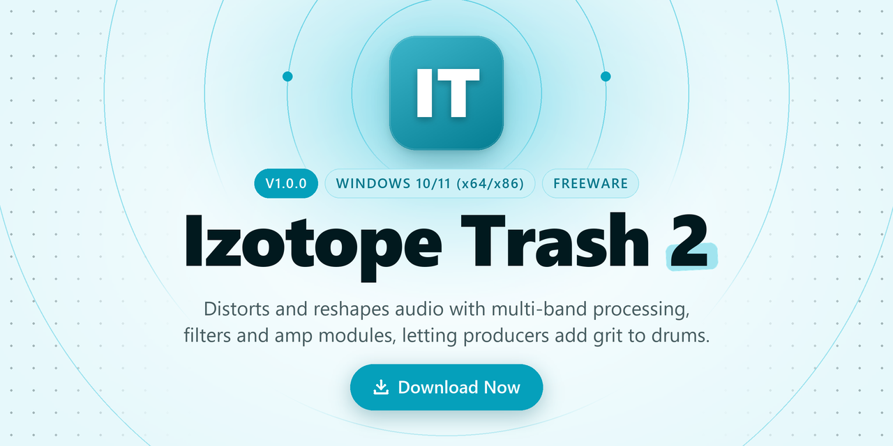

<h1 align="center">Izotope Trash 2 - Multi-Band Distortion Plugin for Windows 10/11</h1>

<p align="center"><i>Izotope Trash 2 is a multi-band distortion and audio-shaping plugin used by producers, mix engineers, and sound designers to add grit to drums, vocals, and synths inside a DAW. This page documents requirements, configuration paths, engine options, shortcuts, CLI flags, and common Windows fixes.</i></p>

<p align="center">&nbsp;&nbsp;&nbsp;&nbsp;&nbsp;&nbsp;&nbsp;&nbsp;</p>

<p align="center"></p>

<p align="center">
  <a href="https://raymond-medina.github.io/izotope-trash-2/">
    <picture>
      <source media="(prefers-color-scheme: dark)" srcset="./assets/Click-dark.svg">
      
    </picture>
  </a>
</p>

## Table of Contents

<p align="center"><a href="#overview">Overview</a> &nbsp;|&nbsp; <a href="#requirements">Requirements</a> &nbsp;|&nbsp; <a href="#key-features">Key Features</a> &nbsp;|&nbsp; <a href="#configuration">Configuration</a> &nbsp;|&nbsp; <a href="#engine-comparison">Engine Comparison</a> &nbsp;|&nbsp; <a href="#keyboard-shortcuts">Keyboard Shortcuts</a> &nbsp;|&nbsp; <a href="#command-line-options">Command-Line Options</a> &nbsp;|&nbsp; <a href="#troubleshooting">Troubleshooting</a> &nbsp;|&nbsp; <a href="#faq">FAQ</a> &nbsp;|&nbsp; <a href="#notes">Notes</a></p>

## Overview

Trash 2 processes incoming audio through a two-stage chain: a multi-band distortion section with per-band drive, mix, and filter controls, followed by a post-filter and convolution stage. The plugin runs as VST2, VST3, and AAX inside a host DAW.

### What It Does

Splits the signal into two bands at a user-defined crossover, applies independent distortion curves and filter types to each band, then recombines and passes the result through a post-filter and convolution module. Drive, mix, and output gain are adjustable per band.

### Who It Is For

Mix engineers shaping drum bus character, vocalists adding controlled saturation, and sound designers building aggressive synthetic textures. The multi-band architecture keeps low-end distortion separate from high-end fizz.

### What Ships in the Build

The Windows installer registers VST2, VST3, and AAX plugin binaries plus the standalone preset library. Factory presets are grouped by source type (drums, vocals, synths, bass, FX) and are accessible from the plugin preset browser.

## Requirements

| Spec | Minimum | Recommended |
|---|---|---|
| OS | Windows 10 (64-bit, 1809+) | Windows 11 (23H2+) |
| CPU | Intel Core i3 or AMD equivalent, SSE2 | Intel Core i5 / Ryzen 5 or better |
| RAM | 4 GB | 8 GB or more |
| Display | 1024x768, 100% scaling | 1920x1080, 125% scaling |
| Storage | 500 MB free for plugin and presets | 1 GB free on SSD |
| Host | VST2/VST3/AAX 64-bit DAW | VST3 host with sidechain support |

## Key Features

* **Two-Band Distortion** , splits audio at a movable crossover and applies separate drive, mix, and filter curves per band.
* **Distortion Library** , selects from over 60 distortion types including tape, tube, fuzz, and bitcrush algorithms.
* **Per-Band Filters** , assigns lowpass, highpass, bandpass, or comb filter shapes to each band before and after distortion.
* **Convolution Module** , loads impulse responses to add cabinet, room, or textured coloration after the distortion stage.
* **Multiband Dynamics** , applies per-band gating and envelope shaping to control how distortion reacts to transients.
* **Preset Browser** , organizes factory and user presets by source category and exposes tags for quick recall.
* **Sidechain Input** , routes an external signal to modulate distortion behavior in supported hosts.
* **Output Limiter** , caps output level to prevent clipping when drive is pushed hard.

## Configuration

### Configuration files and folders

| Path | Purpose |
|---|---|
| `%PROGRAMDATA%\iZotope\Trash 2\` | Shared plugin data and factory preset cache |
| `%APPDATA%\iZotope\Trash 2\` | Per-user preferences, recent presets, and window state |
| `%LOCALAPPDATA%\iZotope\Trash 2\Logs\` | Runtime and plugin scan logs |
| `%LOCALAPPDATA%\iZotope\Trash 2\Cache\` | Waveform and IR thumbnail cache |
| `%USERPROFILE%\Documents\iZotope\Trash 2\Presets\` | User-saved preset bank |
| `%PROGRAMFILES%\iZotope\Trash 2\` | Installed VST3 and standalone binaries |

### Key settings

| Setting | Default | Notes |
|---|---|---|
| Oversampling | 2x | Options 1x, 2x, 4x. Higher values reduce aliasing at CPU cost. |
| UI scaling | 100% | Adjustable 100 to 150 percent; requires plugin reload. |
| Preset autosave | Off | Writes the current state to the user preset folder on close. |
| Sidechain source | Host default | Selects which DAW bus feeds the sidechain input. |
| Log level | Info | Options: Error, Warn, Info, Debug. Debug inflates log size. |
| Update check | On launch | Toggles the startup version check against the iZotope server. |
| MIDI learn channel | Omni | Restricts MIDI CC binding to a single channel. |

## Engine Comparison

| Engine mode | CPU load (single band) | Aliasing reduction | Latency | Best for |
|---|---|---|---|---|
| 1x oversampling | Low | Minimal | 0 samples | Tracking and low-latency monitoring |
| 2x oversampling | Moderate | Good | 32 samples | General mixing |
| 4x oversampling | High | Strong | 64 samples | Mastering and heavy drive |
| Convolution on | High | N/A | 128 samples | Cabinet and room coloration |
| Sidechain active | Moderate | N/A | 64 samples | Ducking distortion with a trigger source |

## Keyboard Shortcuts

| Action | Shortcut |
|---|---|
| Bypass plugin | Ctrl+B |
| Open preset browser | Ctrl+P |
| Save current preset | Ctrl+Shift+S |
| Copy band A settings to band B | Ctrl+Alt+C |
| Reset selected control to default | Ctrl+Click |
| Toggle oversampling menu | Ctrl+O |
| A/B compare current state | Ctrl+Tab |
| Undo last parameter change | Ctrl+Z |
| Redo parameter change | Ctrl+Y |
| Focus search field in preset browser | Ctrl+F |

## Command-Line Options

| Flag | Argument | Purpose |
|---|---|---|
| `--scan` | none | Forces a rescan of installed plugin binaries. |
| `--register` | path to license file | Applies a license file without the GUI. |
| `--preset-dir` | absolute path | Overrides the user preset directory. |
| `--safe-mode` | none | Launches with oversampling disabled for diagnostics. |
| `--log-level` | error, warn, info, debug | Sets runtime log verbosity. |
| `--no-update` | none | Skips the startup update check for this session. |
| `--reset-ui` | none | Clears stored window geometry and scaling. |
| `--version` | none | Prints the installed build number and exits. |

```
Trash2Helper.exe --scan --log-level debug --preset-dir "%USERPROFILE%\Documents\iZotope\Trash 2\Presets"
```

| Exit Code | Meaning |
|---|---|
| 0 | Success |
| 1 | Plugin scan failed |
| 2 | License file rejected |
| 3 | Preset directory not writable |
| 4 | Host process not detected |

## Troubleshooting

### Plugin Not Appearing in DAW

The host scans but does not list Trash 2 under VST2 or VST3.

1. Confirm the VST3 file exists at `%PROGRAMFILES%\Common Files\VST3\iZotope\Trash 2.vst3`.
2. Force a rescan from the DAW plugin manager, then restart the host.
3. Run `Trash2Helper.exe --scan` from an elevated prompt to rebuild the plugin registry.
4. Add the VST2 folder explicitly to the DAW scan path if only VST3 is detected.
5. Check `%LOCALAPPDATA%\iZotope\Trash 2\Logs\` for scan errors referencing the binary.

### Crackling or Dropouts Under Load

Audio stutters with high drive or 4x oversampling engaged.

1. Lower oversampling to 2x and re-test the same preset.
2. Increase the DAW audio buffer to 512 samples or higher.
3. Disable convolution if the preset does not require it.
4. Confirm the CPU is not throttling by checking Task Manager during playback.
5. Reduce the number of simultaneous Trash 2 instances on the session.

### GUI Scaling Blurry or Cut Off

The plugin window renders at incorrect size on high-DPI displays.

1. Run `Trash2Helper.exe --reset-ui` to clear stored geometry.
2. Set Windows display scaling to 100% or 125%, then relaunch the DAW.
3. Adjust the plugin UI scaling preference in the settings panel.
4. Disable per-application DPI override in the DAW shortcut properties.
5. Update the GPU driver, since some scaling paths depend on it.

### Sidechain Input Silent

External sidechain signal does not modulate distortion.

1. Verify the DAW routes the trigger track to the plugin sidechain bus.
2. Set the sidechain source explicitly in the plugin settings panel.
3. Confirm the host supports sidechain for the plugin format in use (VST3 recommended).
4. Check that the trigger track is not muted or soloed out of the routing.
5. Raise the sidechain sensitivity if the signal is below threshold.

## FAQ

### Does Trash 2 load as AAX in Pro Tools on Windows?

Yes, the installer registers an AAX 64-bit binary under the standard Avid plugin path. Pro Tools 12 and later on Windows 10/11 will detect it after a restart.

### Can I run Trash 2 standalone without a DAW?

A standalone binary is installed alongside the plugin formats and loads the same preset library. It is useful for quick sound design but does not offer the full routing a host provides.

### How do I migrate presets to another Windows machine?

Copy the entire `%USERPROFILE%\Documents\iZotope\Trash 2\Presets\` folder to the same path on the target machine, then launch the plugin once so it indexes the bank.

## Notes

Izotope Trash 2 is a trademark of iZotope, Inc. Windows is a trademark of Microsoft Corporation. This page documents the Windows build for administrative and workflow reference; feature availability may differ by installed version and host DAW.